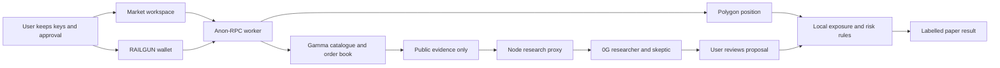

# 0xPay

A browser privacy wallet with Anon-RPC enabled by default.

RAILGUN supplies shielded balances and payments. Anon-RPC routes supported blockchain requests through an anonymizing worker. If that route fails, protected requests stop instead of switching to direct RPC. Keys are encrypted locally in the browser.

## Run

Node 24:

```sh
npm ci
npm run dev
```

Checks: `npm run lint`, `npm test`, `npm run build`.

For the optional 0G research service, copy `.env.server.example` to `.env.server`, configure your server-side key, and run `npm run api` in another terminal. Never use a `VITE_*` variable for a key. The development server proxies `/api` to port 4203. Open `?view=agents` for the separate prediction-market workspace.

## What works and what still needs proof

A real Sepolia shield and spendable sender balance have been observed. A complete private payment with independently confirmed recipient spendability remains unverified. Preserve the original wallet and recovery words; do not treat this prototype as a production wallet.

## Prediction-market extension

The `work/polymarket-agents` branch adds real Polymarket catalogue/order-book reads, protected Polygon position checks, and a local paper journal. A local exposure rule combines actual outcome holdings, this browser's paper shares and the proposed purchase under a user-set cap. Budget, price, expiry and interruption checks run again before recording.

The 0G researcher/skeptic accepts public evidence only; account state and risk limits remain local. Adopting model research requires explicit user review and never grants signing authority.

An EOA-signed EIP-712 mandate binds the assessed account, paper session, allowed markets, limits and expiry. Local revocation and committed spend are checked again under the paper journal's write lock. This is browser-local paper authorization, not an onchain allowance or permission to sign transactions. An isolated ENSv2 read adapter exists, but the proposed agent names are unverified and the adapter is not wired into the application.

Browser runs have observed catalogue/order-book requests through Nox and a real Polygon position snapshot through Nym. A restricted free-credit 0G key is configured for local testing; live inference has returned HTTP 502 and no successful model response has been verified. Manual paper mode is labelled separately. No real venue orders or autonomous trades are submitted. A RAILGUN balance does not directly fund this workspace.

The current evidence pack contains retrieved venue rules and an order-book snapshot, not independent news research. A model may abstain; estimates are not verified forecasts.



## CROPS

Privacy is the primary focus: reduce direct IP/query linkage for supported wallet and application reads, with the limits below.

- **C — Censorship resistance:** users can build and host the frontend locally. Supported operations still depend on worker/bootstrap RPC, bundle resolvers, chain endpoints and SDK services; research also needs the Node proxy and 0G. Failure stops affected operations rather than switching to direct RPC.
- **O — Open source:** [MIT licensed](LICENSE.md), with setup commands above. RAILGUN and the Anon-RPC harness are reused; optional hosted research needs a separately configured server key. No client analytics integration is included.
- **P — Privacy:** supported RPC and market reads use the worker by default. Bootstrap/bundle hosts see their direct requests; POI/indexer/proof downloads remain direct and expose IP/service metadata. The research proxy sees client IP and public evidence, while account holdings and user limits remain local.
- **S — Security:** recovery words and keys stay on-device, encrypted in browser storage when locked. Users control signing. Trust remains in the shipped frontend, dependencies, browser and bootstrap-provided worker hash; model output cannot grant spending authority. This prototype is not independently audited.

These routes reduce direct IP/query linkage; they do not prove packet-level anonymity, honest RPC data, or private public-chain positions/orders. A RAILGUN balance is not Polymarket collateral.

Built with React, TypeScript, ethers, the RAILGUN Wallet SDK and the Anon-RPC browser harness. Existing protocol and network implementations are reused; 0xPay supplies the interface, transport enforcement and recovery logic.

The Node service is intended for local testing until authenticated access or durable spending controls are configured. Its process-local job allowance is not production authentication. GitHub Pages hosts only the frontend; it cannot execute the research service. A public full-stack deployment remains unverified.

[Anon-RPC](https://ethereum.github.io/anon-rpc/wallets/) · [RAILGUN SDK](https://docs.railgun.org/developer-guide) · [Source](https://github.com/Anand-0037/0xpay)
