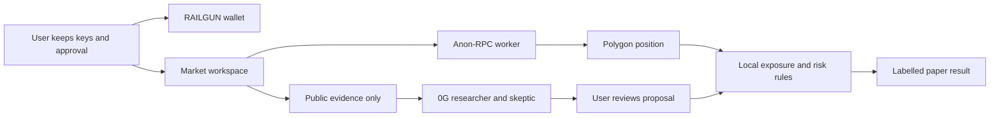

# 0xPay

A browser privacy wallet with Anon-RPC enabled by default.

RAILGUN supplies shielded balances and payments. Anon-RPC routes supported blockchain requests through an anonymizing worker. If that route fails, protected requests stop instead of switching to direct RPC. Keys are encrypted locally in the browser.

## Run

Node 24:

```sh
npm ci
npm run dev
```

Checks: `npm run lint`, `npm test`, `npm run build`.

For the optional 0G research service, copy `.env.server.example` to `.env.server`, configure your server-side key, and run `npm run api` in another terminal. Never use a `VITE_*` variable for a key. The development server proxies `/api` to port 4203. Open `?view=agents` for the separate prediction-market workspace.

## What works and what still needs proof

A real Sepolia shield and spendable sender balance have been observed. A complete private payment with independently confirmed recipient spendability remains unverified. Preserve the original wallet and recovery words; do not treat this prototype as a production wallet.

## Prediction-market extension

The `work/polymarket-agents` branch adds real Polymarket catalogue/order-book reads, protected Polygon position checks, and a local paper journal. A local exposure rule combines actual outcome holdings, this browser's paper shares and the proposed purchase under a user-set cap. Budget, price, expiry and interruption checks run again before recording.

The 0G researcher/skeptic accepts public evidence only; account state and risk limits remain local. Adopting model research requires explicit user review and never grants signing authority.

Live market access and a Polygon position snapshot through the Nym worker have been observed. The 0G adapter and UI are implemented, but real inference remains unverified until an authorized credit budget and server key are configured. Manual paper mode is labelled separately. No real venue orders or autonomous trades are submitted. A RAILGUN balance does not directly fund this workspace.

The current evidence pack contains retrieved venue rules and an order-book snapshot, not independent news research. A model may abstain; estimates are not verified forecasts.



## Privacy boundaries

Anon-RPC reduces direct IP/query linkage at the RPC endpoint. It does not hide public transactions or positions, prove that RPC data is honest, or make authenticated venue orders anonymous. Bootstrap, worker downloads and the wallet's POI/indexer/proof services have separate network paths. Market APIs and hosted AI tools must be accounted for separately. RAILGUN funds are not automatically Polymarket collateral.

Built with React, TypeScript, ethers, the RAILGUN Wallet SDK and the Anon-RPC browser harness. Existing protocol and network implementations are reused; 0xPay supplies the interface, transport enforcement and recovery logic.

The Node service is intended for local testing until authenticated access or durable spending controls are configured. Its process-local job allowance is not production authentication. GitHub Pages hosts only the frontend; it cannot execute the research service.

[Anon-RPC](https://ethereum.github.io/anon-rpc/wallets/) · [RAILGUN SDK](https://docs.railgun.org/developer-guide) · [Source](https://github.com/Anand-0037/0xpay)
